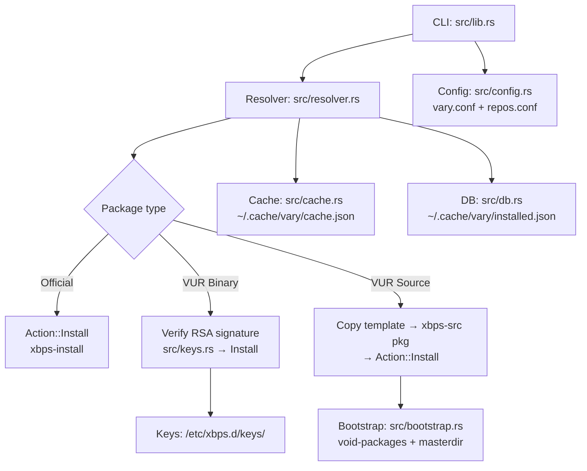

[English](README.md) | [Español](README.es.md)

# vary

A community package manager for **Void Linux**, built on top of `xbps` and `xbps-src`.

> **Fork of [paru](https://github.com/Morganamilo/paru).** vary reuses paru's user experience (familiar interface, interactive search and install) but talks exclusively to the XBPS ecosystem: no pacman, no ALPM. The port and current development are by **Dicov ([SrDicov](https://github.com/SrDicov))**; all credit for the original work goes to Morganamilo and the paru community.

Its core piece is the **VUR** protocol: distributed Git repositories that combine `void-packages`-style templates with a declarative `.VURINFO` (JSON) index generated by CI, plus optional HTTP-served binaries signed with `xbps-rindex`.

## Status

**MVP under development.** Only `main` (stable) and `testing` (integration) exist; installed on `testing`: command interfaces and formats may change without notice.

## Requirements

- **Void Linux** with `xbps` and `xbps-src` installed (plus `base-devel` to compile).
- **`git`** — used to clone `void-packages` and VUR repos. It is mandatory: if missing, vary fails at startup with `git es requerido por vary pero no está instalado. Instálalo con: xbps-install git`.

## Guide

**Full usage guide (from zero, no paru/pacman knowledge required): [`docs/GUIA.md`](./docs/GUIA.md)** (in Spanish) — every command, every flag, every config key, with real output.

## Quick start

There are no manual bootstrap steps: whenever there is something to build or install (`vary -S <pkg>`, or an upgrade with packages to rebuild), vary automatically clones `void-packages` into `~/.cache/vary/void-packages`, prepares the `xbps-src` *masterdir*, and creates its local caches. A `vary -Syu` with nothing to upgrade does not need (and does not do) any of that.

```sh
# Sync the VUR repositories
vary -Sy

# Install a package (this is what bootstraps void-packages and the masterdir)
vary -S firefox

# Search official repos and registered VURs
vary -Ss firefox

# Install a package
vary -S firefox

# Register a remote VUR repo (cloned into ~/.local/share/vary/vurs/ and
# registered in /etc/xbps.d/20-vur-<name>.conf).
# The default branch is auto-detected (main, master, ...); override with --branch.
vary --repo add https://git.example.com/user/vur.git
vary --repo add https://github.com/SrDicov/z-packages z-packages --branch master
```

Other commands available in the MVP: `-Si` (detailed info), `-Sw` (download without installing), `-R` (remove), `--repo list|remove|rekey|re-trust` (re-trust re-affirms a rotated repo key), `--force-build` (build from source even if a binary exists: prefers source candidates across repositories and overrides the official bucket when a VUR template exists — warns explicitly when it can't) and `--prefer-binary` (prefer signed binaries, switching repositories when needed; `--no-prefer-binary` forces the source path). Without these flags the historical precedence applies (official first, then the merged VUR candidate). `--yes` is an alias of `--noconfirm` (note: `-y` means refresh, not yes); `--asdeps`/`--asexplicit` are rejected (vary always installs as explicit). `-Sp` prints the install plan (topological levels, single binary batch, estimated elevations) without changing anything: script-parseable, no lock, no elevation (the VUP index may refresh its cache read-only, like `-Sy`). `--lock` (re)generates `~/.config/vary/vary.lock` (repos + packages pinned); install/upgrade warn on divergence. `--challenge <pkg> --experimental` rebuilds and compares against installed files. `--why <pkg>` explains what pulls a package; `--log [pkg]` shows the operation history. `-Q` (alias `--query`) lists the installed packages, one `name version` per line (read-only, no lock, no elevation); with arguments it filters by substring, like `pacman -Q`.

### Word form (kyoz-style)

Every operation also has a word form, so you don't have to remember the flags:

```sh
vary install <pkg...>   # = vary -S <pkg...>
vary update             # = vary -Syu (refresh + rebuild + merge)
vary remove <pkg...>    # = vary -R <pkg...>   (alias: r)
vary search <query>     # = vary -Ss <query>    (alias: s)
vary info <pkg...>      # = vary -Si <pkg...>    (alias: i)
vary list [pattern]     # = vary -Q             (alias: ls)
```

The word form is a translation of the existing flags — same sets, same plans, same locks, same confirmations. One-letter aliases always match their flag (`i` is info, like `-i`; `u` is update, like `-u`), and with an explicit flag the first word is a **package name** (`vary -S s` installs the package `s`, `vary s` searches).

## Package sets (`@name`)

Instead of package names, `-S` accepts special targets that `@`-expand into lists of packages (deduplicated, first-seen order preserved, mixed with literal package names):

| Set         | Expands to                                            |
|-------------|-------------------------------------------------------|
| `@selected` | manually installed packages (`xbps-query -m`)         |
| `@installed`| every installed package (`xbps-query -l`)             |
| `@system`   | `base-system`                                         |
| `@world`    | `@selected` + `@system` (dedup)                       |
| `@optimized`| packages vary has compiled from source (its DB)       |
| `@vur`      | packages whose origin is a registered VUR (its DB)    |
| `@preserved-rebuild` | source-built packages whose soname pins have drifted (its DB) |

```sh
# Rebuild from source everything currently installed
vary -S --force-build @installed
```

Notes: an empty set is an error (nothing actionable to install). `-Syu` without targets does not expand sets (sets are install targets, not upgrade ones). `@system` is literally `base-system`; to build its full dependency tree from source, use `--deep`:

```sh
vary -S --deep --force-build @installed
```

### `@preserved-rebuild`

When vary installs a package **from source**, it records which installed provider served each required shared library (soname pins). On upgrade, if a provider bumped its version (or no longer provides the soname), vary prints a consultative warning — **it never rebuilds anything on its own** (rebuilding without explicit consent is dangerous). (The only exception is the *source-tree* bump check: when `common/shlibs` shows that the provider of a soname you depend on moved to a newer version, the consumers enter the upgrade plan and are rebuilt in that same transaction, before the merge.) `@preserved-rebuild` expands to exactly those drifted packages so you can rebuild them explicitly:

```sh
vary -S --force-build @preserved-rebuild
```

Notes: only source-built packages (the DB carries no pins for binary installs), and only if any of their pins drifted; an empty set is an error. It does not yet preserve the old `.so` on disk — if a provider is upgraded, the old ABI may already be gone: run `-S --force-build @preserved-rebuild` promptly after such a warning.

`--deep` (alias `--deep-build`) passes `-N` to xbps-src: it builds without remote repositories, compiling missing dependencies from source while reusing the local repo (`hostdir/binpkgs`) for what was already built. It can fail if any dependency's source or distfile is not available; CLI flag only (no `vary.conf` option).

### Rebuilding when the inputs change (`--newoptions`, `--changed-flags`, `--changed-deps`)

When vary installs a package **from source**, it records what it was built with: the active build options, the compiler flags, the hashes of your own patches/config files and the hash of the template. A package whose `pkgver` did not change can still be obsolete: you switched `-O2` for `-O3 -march=native`, added a patch, or void-packages changed the template.

`--newoptions` rebuilds the source-built packages whose **options, user patches or template** changed; `--changed-flags` (short `-U`) rebuilds those whose **compiler flags** changed; `--changed-deps` rebuilds those whose **dependency moved in the source tree**:

```sh
vary -S --changed-flags        # cambiaste CFLAGS en vary.conf
vary -S --newoptions           # tocaste tus parches/opciones o el template
vary -Syu --changed-deps       # una dep del árbol cambió de versión desde el build
```

Notes: the audit only considers packages **built by vary** (official binaries are never rebuilt for this) and only when there is a baseline recorded — a package installed before this feature has no baseline, so it is not touched (no invented rebuilds). The baseline is recorded for the **source package**: the subpackages of an official source build (`gmpxx`, `gmp-devel`, …) get no entry of their own, so they are not audited individually (rebuilding the parent rebuilds them all). The plan explains each rebuild (`rebuild de 'linux': banderas cambiadas`). There is no short flag for `--newoptions`: `-N` already means "no remote repositories" in xbps-src and is used by `--deep`. The audit is a **plan-time** decision: it never rebuilds anything on its own, you still have to ask for the install.

`--changed-deps` is **opt-in** because a dependency version bump does not always break a binary: with dynamic linking the new library is picked up at run time, and a SONAME bump is already reported on its own (`@preserved-rebuild`). It matters when the dependency is a *build* input (headers, C++ templates, header-only libraries). The baseline is the dependency version in void-packages at build time, so: a dependency that only exists in a VUR gives no signal (no data, no noise); a dependency that exists in **both** void-packages and a VUR is pinned to the tree's version, so a tree bump proposes a rebuild even if the build used the VUR's version (one extra rebuild, opt-in); a dependency **removed** from the tree gives no signal either (that case belongs to the SONAME machinery).

## Config file conflicts (`--conf-update`)

Package upgrades can leave `<file>.new-<pkgver>` files side by side with your current `/etc` configs (e.g. `/etc/passwd.new-0.146_2`). `vary --conf-update` walks `/etc` recursively (without following symlinks) and, for each candidate with a non-empty `.new-<suffix>`, shows `git diff --no-index` of the original against the new file and asks: `[r]eemplazar [k]eep [d]iff [q]uit` (Enter keeps, `d` re-diffs, `q` quits). Replacing makes a `<original>.vary-bak.<pid>` backup before moving the `.new-` file over the original, always through configurable privilege elevation (never direct writes as non-root). Notes: writes never happen without a TTY — with `--noconfirm` or without a TTY it only lists `new -> original` pairs and exits 0; it is an independent command (rejects `-S`/`-R`, targets and `--repo`); it never touches `.so`/library files (those are handled by `@preserved-rebuild`, above); take it as the prompt you get, and review diffs before pressing `r`.

### Source index, virtuals and conditional dependencies

`-Sy` now also updates the void-packages checkout (it used to stay frozen at the clone's commit) and refreshes the local source index (`~/.cache/vary/portdb.json`): package versions, build options and the `SONAME -> provider` map from `common/shlibs`. The refresh is incremental — only the templates touched by the new commit are re-read — and a change in `common/build-style`/`common/build-helper` triggers a full reindex (every entry depends on them). Templates whose version is computed by shell cannot be parsed statically: they are marked as such and resolved with `xbps-src show` when needed.

Virtual packages are resolved through `etc/defaults.virtual` plus the local `etc/virtual` override, so `vary -S ntp-daemon` installs the real package that provides it.

Dependencies conditioned on build options (`$(vopt_if ...)` in the templates) are reduced with your active options before the dependency graph is built, so they never enter it as bogus package names (`$(vopt_if`).

## Configuration

User configuration lives in `~/.config/vary/vary.conf` (optional; full example in [`etc/vary.conf.example`](./etc/vary.conf.example)):

```toml
[general]
cache_dir = "~/.cache/vary"
data_dir = "~/.local/share/vary"
log_level = "info"

[build]
max_concurrent_builds = 2
force_rebuild = false

[search]
ttl_cache_seconds = 3600
```

Privilege escalation is tool-agnostic: vary uses whatever is configured via `--sudo` / `sudo_bin` (`sudo`, `doas`, `run0`), auto-detects in that order when unset, and skips the wrapper entirely when running as root.

VUR repos are declared in `~/.config/vary/repos.conf`:

```toml
[vur.my-vur]
url = "https://git.example.com/user/vur.git"
branch = "main"
priority = 10
# Optional: VUP-style remote binary index (index.json). When set, vary
# installs that repo's binaries for your architecture without needing
# .VURINFO or templates (Phase 1 adapter, binary only).
# index_url = "https://vup-linux.github.io/vup/index.json"
```

Repos that publish a VUP-style `index.json` (e.g. VUP-Linux/vup) can be used
for binary installs:

```sh
vary --repo add https://github.com/VUP-Linux/vup vup \
  --index-url https://vup-linux.github.io/vup/index.json
vary -S vlang   # binary install from the matching release repo
```

Notes: needs `curl` (configurable via `--curl` / `[general] curl_bin`); the
repo's `keys/*.plist` key is verified like any VUR key (`key_fingerprint`
in repos.conf); source builds from such repos are not supported yet. On the
first binary install vary pre-imports the key into the xbps keyring, so only
vary's own trust confirmation is asked (no second xbps key-import prompt).
The fingerprint vary prints matches xbps's: pin it via `key_fingerprint`.

## Binary repository

A rolling XBPS repository with signed packages lives at a fixed URL and is refreshed on every successful build:

```sh
echo 'repository=https://github.com/SrDicov/Vary/releases/download/repo' | sudo tee /etc/xbps.d/20-vary.conf
sudo xbps-install -S        # accept the RSA fingerprint when prompted
sudo xbps-install vary      # later: sudo xbps-install -Su keeps it current
```

Both glibc and musl are served from that single URL (`x86_64` / `x86_64-musl`). The musl artifact (`vary-*_1.x86_64-musl.xbps`) is dynamically linked (interpreter `/lib/ld-musl-x86_64.so.1`) and requires a Void musl system to run; it does not run on glibc (verified by the `verify musl` workflow job in a musl container). The signing public key is published as [`keys/vary-repo.pub.pem`](./keys/vary-repo.pub.pem).

## Hybrid source builds (official packages)

Official packages may be compiled from source instead of installing the binary. Patterns are simple globs (`*` / `?`, case-sensitive) in `[build] source_always`; per-package options, flags and build settings go in `[make]` and `[options]`:

```toml
[build]
source_always = ["linux*", "mesa-*"]

[make]
cflags = "-O2 -pipe"
ccache = true            # XBPS_CCACHE=yes
# distcc = true
# distcc_hosts = "localhost/4"
# global_options = ["static"]        # global XBPS_PKG_OPTIONS
# debug_pkgs / check_pkgs / allow_restricted = true

[options]                # XBPS_PKG_OPTIONS_<pkg>; quote keys with dots: ["foo.bar"]
linux = ["pgo", "wayland", "~jack"]
```

Behavior:

- An official package matching `source_always` becomes a source build in the plan (`vary -Sp` shows it as an official source build; its dependencies are handled by `xbps-src` itself — binaries from repos where available, built otherwise — so vary does not expand or track that subgraph). For a matched name a **signed VUR binary never wins**: if a VUR template exists it is compiled from source (existing VUR precedence still applies between VUR candidates).
- `--force-build` on an official package without a VUR template now builds the official from source (previously it warned and installed the binary).
- The build reuses the normal bootstrap/masterdir path (and the experimental parallel workers); each invocation gets its own temporary xbps-src config written as `etc/conf.vary-<id>` and passed with `xbps-src -c`. Your existing `void-packages/etc/conf` is NOT merged into it; within that invocation the generated config replaces it (vary warns once).
- After installing anything from source, vary runs `xbps-pkgdb -m repolock <pkg>` so xbps will not later update it from a foreign repository. Installing an official binary over a locked package runs `repounlock` first. A failed repolock (install flow) is an error, not a silent warning.
- `-Syu` best-effort re-locks Source packages before the official upgrade, and afterwards adds official Source packages matching `source_always` whose template version in the void-packages clone is newer than the installed one (a template it cannot read via `xbps-src show` is skipped with a warning).

Limits: `RUSTFLAGS`/`CFLAGS` are not propagated natively (`RUSTFLAGS` is unset by xbps-src in native builds and there is no `XBPS_RUSTFLAGS`); vary does not emit them. `makejobs` stays in `[build]`. Sub-packages of an official source build are built but only installed when the main package pulls them in; otherwise run `vary -S <sub>` again. `source_always` must name **sourcepkgs** (subpackages are built along with their parent; matching a subpackage name alone does nothing).

## User patches and files

For every source build (official or VUR), vary injects your own content into the source package right before compiling and reverts it afterwards:

- `~/.config/vary/patches/<sourcepkg>/*` → `srcpkgs/<sourcepkg>/patches/999-vary-user-<name>`. The `999-` prefix makes your patches run **after** the template's own patches. If that destination already exists, the build aborts with an error (the prefix makes collisions unlikely).
- `~/.config/vary/files/<sourcepkg>/*` → `srcpkgs/<sourcepkg>/files/<name>`. Files that already exist in the template are backed up as `.vary-bak.<pid>.<name>` and restored afterwards; files that didn't exist are copied and removed afterwards.

Behavior:

- Managed as a transactional overlay: the source package is restored on normal exit, errors, and controlled `SIGINT`/`SIGTERM` interrupts (RAII restoration, running at scope exit). On `SIGKILL`/abort the restoration cannot run and leftovers are possible. Directories you didn't have (`patches/` / `files/`) are removed if the build leaves them empty, and anything the build itself left unused there is not touched.
- Only regular files are copied; symlinks and directories in your config dirs are skipped with a warning (nothing escapes config into `srcpkgs/` via `../..` or links pointing to `/etc`).
- Empty or missing your dirs = no-op: the tree is untouched.
- Works on all build paths: sequential, experimental parallel workers, recursive builds and `--challenge`.

Limits: keys are the **sourcepkg** name (subpackages inherit their parent's build). Nothing is recorded in the installed-package database — if you want to audit which overlay ran on a given binary, keep your `~/.config/vary/patches|files` under version control.

## Architecture



Relevant directories:

| Path | Purpose |
| --- | --- |
| `~/.cache/vary/void-packages/` | `void-packages` checkout used by `xbps-src` |
| `~/.cache/vary/cache.json` | search/metadata cache |
| `~/.cache/vary/installed.json` | database of packages managed by vary |
| `~/.cache/vary/logs/` | build logs |
| `~/.local/share/vary/vurs/` | local clones of VUR repos |
| `~/.config/vary/vary.conf`, `~/.config/vary/repos.conf` | user configuration |
| `/etc/xbps.d/10-vary.conf`, `/etc/xbps.d/20-vur-<name>.conf` | xbps integration |

## Known limitations (MVP)

During the MVP, vary favors simplicity over completeness: VUR dependency resolution is based on the declarative `.VURINFO` index published by each repository, not on fully evaluating templates on your machine. That implies important restrictions described below, plus planned features that are still missing (see roadmap).

> NOTE ON DYNAMIC VARIABLES: The .VURINFO generated by scripts/vur-generator.sh reflects DEFAULT build options (no active XBPS_PKG_OPTIONS). If the end user builds with custom options (XBPS_PKG_OPTIONS_<pkg>), initial dependency resolution may be incomplete. xbps-src will handle additional dependencies during the real build. This is acceptable for the MVP: DAG resolution is an optimization to minimize unnecessary builds, not a completeness guarantee.

Use `-v`/`-vv` for DEBUG/TRACE console output (`RUST_LOG` overrides them); `log_level` in `vary.conf` sets the default level.

## Roadmap

- **Concurrent builds (shipped, opt-in):** builds run level by level in parallel sandboxes (overlayfs) when `--experimental` and `max_concurrent_builds > 1`; by default builds are sequential (no tokio, no async runtime: the scheduler is plain threads and `waitpid`).
- **Phase 2 — automated `regen-aur`:** a `vary --repo regen-aur <pkg>` style command to refresh AUR-derived templates without manual steps (see [`docs/AUR2XBPS.md`](./docs/AUR2XBPS.md)).

## License & credits

GPL-3.0. vary is a port of the excellent work by Morganamilo and the [paru](https://github.com/Morganamilo/paru) community; all credit for the original authorship belongs to them. The Void Linux/XBPS port and current development are by **Dicov ([SrDicov](https://github.com/SrDicov))**. See [LICENSE](./LICENSE).
